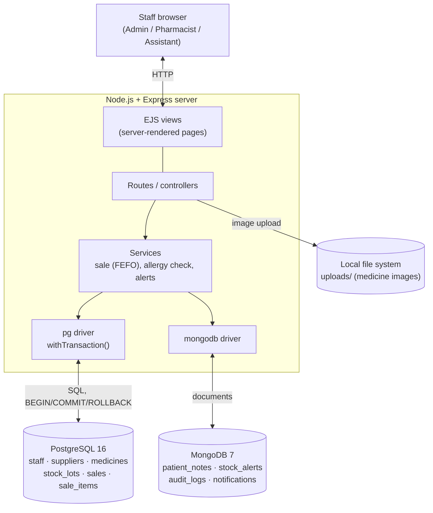
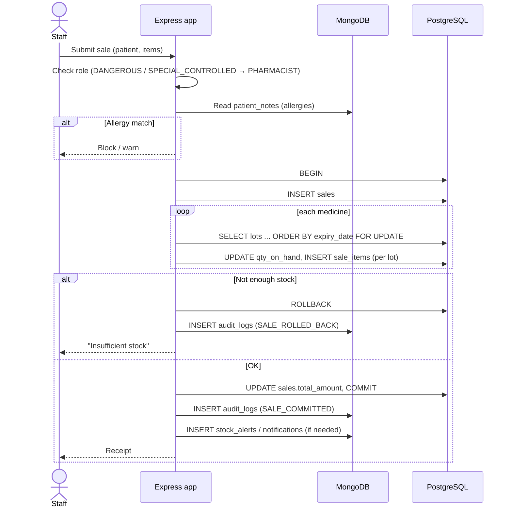

# System Architecture

Everything runs locally: no external APIs, no cloud databases, images on the server's own disk.

## Sale flow across both databases

Known limitation: the MongoDB writes happen after the SQL commit. If a MongoDB write fails, the sale stands without its log entry.
