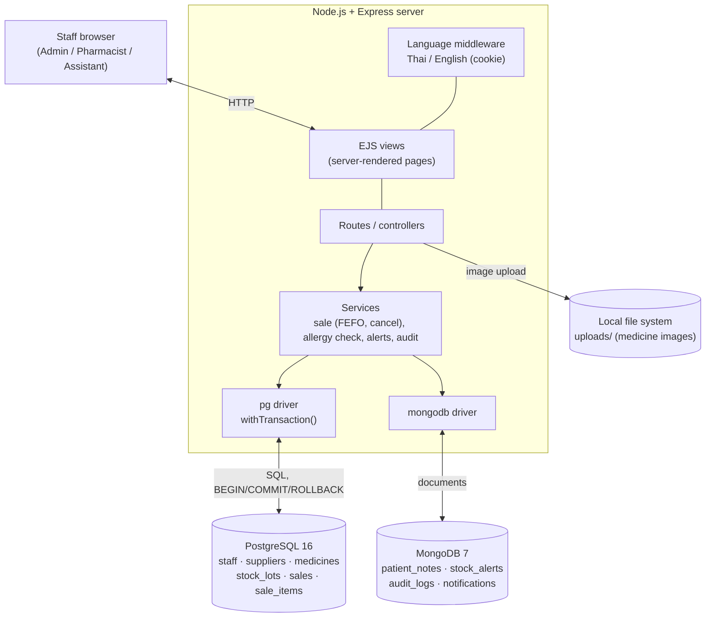
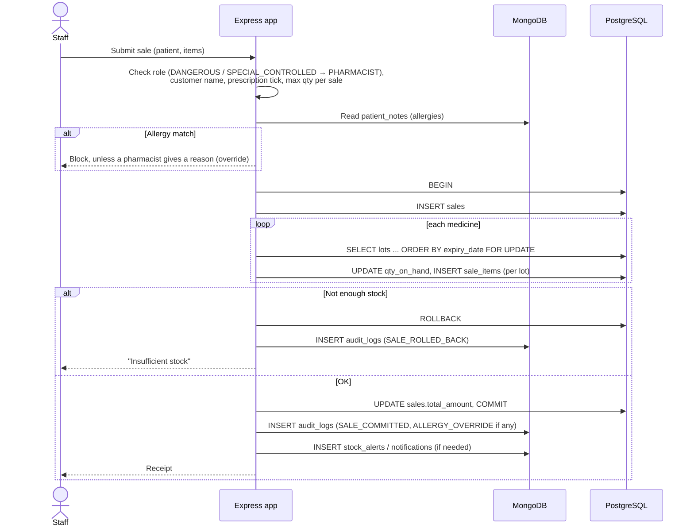

# System Architecture

Everything runs locally: no external APIs, no cloud databases, images on the server's own disk.

## Sale flow across both databases

Cancelling a bill is a second transaction: it returns each quantity to the lot it came from and marks the sale cancelled; if a lot was adjusted afterwards and the return would break a stock rule, the whole cancel rolls back. It writes `SALE_CANCELLED` to `audit_logs` after commit.

Known limitation: the MongoDB writes happen after the SQL commit. If a MongoDB write fails, the sale stands without its log entry.
