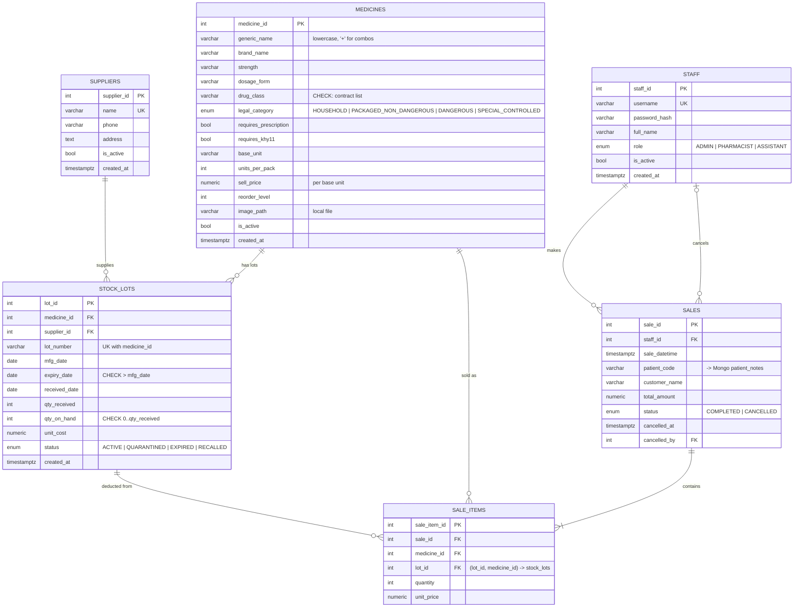

# SQL ER Diagram (PostgreSQL)

Source of truth: `db/sql/001_schema.sql`. GitHub renders this Mermaid diagram automatically.

## Design notes

- **One `sale_items` row per lot deducted.** FEFO can split one medicine across several lots, so a bill for 30 tablets may produce two rows (e.g. 20 from lot A, 10 from lot B).
- **Composite FK `(lot_id, medicine_id)`** guarantees a sale line can't claim a lot that belongs to a different medicine.
- **`ON DELETE RESTRICT` everywhere.** Medicines, lots and staff with history can't be deleted; deactivate them (`is_active`, `status`) instead. Deleting a sale is a cancellation transaction that returns stock.
- **Partial index `idx_stock_lots_fefo`** on `(medicine_id, expiry_date, received_date) WHERE status = 'ACTIVE'` serves the FEFO lookup.
