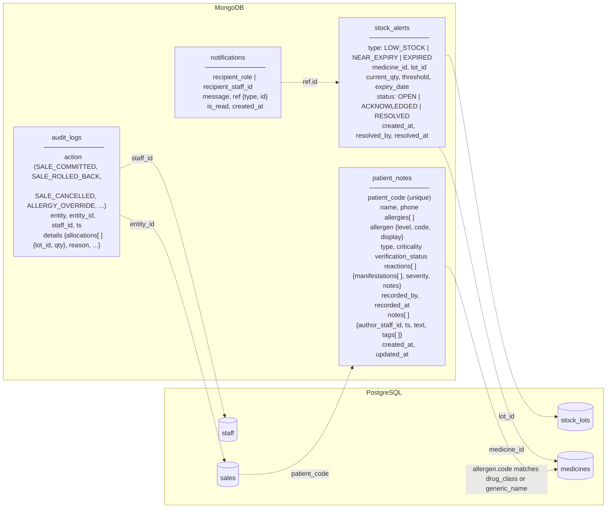

# NoSQL Document Schema (MongoDB)

Source of truth: `database/mongo/collections.js` (each collection has a `$jsonSchema` validator).

Dotted lines are logical references checked by the application. MongoDB and PostgreSQL can't enforce foreign keys between each other.

## Why each collection is in NoSQL

| Collection | Reason |
|---|---|
| `patient_notes` | Nested, variable structure: each patient has a different number of allergies, each allergy a different number of reactions and symptoms. Matches the HL7 FHIR AllergyIntolerance shape. |
| `stock_alerts` | Fields differ by alert type (expiry alerts have a lot and date, low-stock alerts don't). Created and resolved often. |
| `audit_logs` | Append-heavy; `details` differs per action (a sale stores lot allocations, a lot update stores old/new values). |
| `notifications` | Short-lived messages, addressed to a role or a person; read/unread status changes often. |

## When each collection is written

| Collection | Written when | Web page |
|---|---|---|
| `patient_notes` | Create / edit / delete patient, add / remove allergy, add / delete note; **read before** every sale to check allergies | `/patients` |
| `stock_alerts` | After a sale commits and stock falls to `reorder_level` or below; when staff press "scan stock now" (expiry and low stock, `NEAR_EXPIRY_DAYS`, default 180); status changed OPEN → ACKNOWLEDGED → RESOLVED; only RESOLVED alerts can be deleted | `/alerts` |
| `audit_logs` | After every commit **and after every rollback** (`SALE_ROLLED_BACK`), bill cancellation, allergy override, and each create / update / delete of medicines, lots, suppliers, staff, patients | `/audit` (view; admin can delete old entries) |
| `notifications` | After every committed sale (message to the pharmacist) and when an alert is raised; staff can also send a message to a role or a person; recipients mark read or delete | `/notifications` |

Indexes (see `database/mongo/collections.js`): `patient_notes.patient_code` unique; `stock_alerts` on `(status, type)` and `medicine_id`; `audit_logs` on `ts` descending and `(entity, entity_id)`; `notifications` on `(recipient_role, is_read, created_at)`.

`audit_logs` entries cannot be edited. Only an admin can delete entries older than a chosen number of days, and that deletion is itself logged (`AUDIT_PURGED`).

See `docs/data-contract.md` for the allergen format and matching rule.
