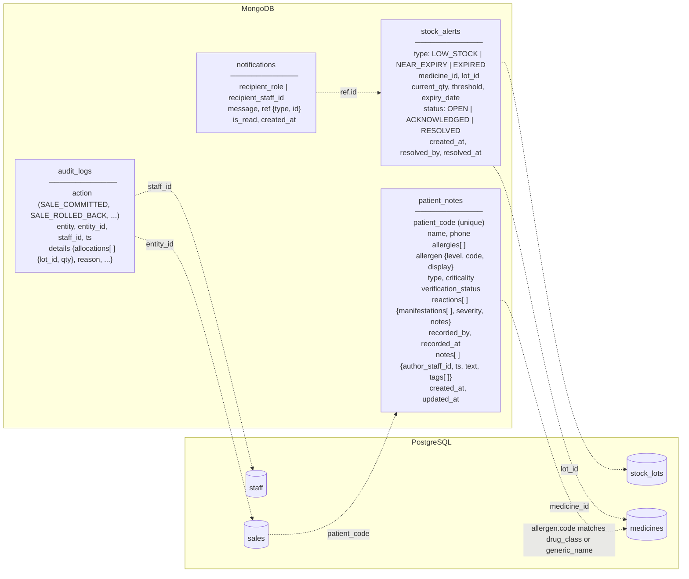

# NoSQL Document Schema (MongoDB)

Source of truth: `db/mongo/collections.js` (each collection has a `$jsonSchema` validator).

Dotted lines are logical references checked by the application. MongoDB and PostgreSQL can't enforce foreign keys between each other.

## Why each collection is in NoSQL

| Collection | Reason |
|---|---|
| `patient_notes` | Nested, variable structure: each patient has a different number of allergies, each allergy a different number of reactions and symptoms. Matches the HL7 FHIR AllergyIntolerance shape. |
| `stock_alerts` | Fields differ by alert type (expiry alerts have a lot and date, low-stock alerts don't). Created and resolved often. |
| `audit_logs` | Append-heavy; `details` differs per action (a sale stores lot allocations, a lot update stores old/new values). |
| `notifications` | Short-lived messages, addressed to a role or a person; read/unread status changes often. |

## When each collection is written

| Collection | Written when |
|---|---|
| `patient_notes` | CRUD from the patient page; **read before** a sale to check allergies |
| `stock_alerts` | After a sale commits and stock falls to `reorder_level` or below; during the expiry scan (`NEAR_EXPIRY_DAYS`, default 180) |
| `audit_logs` | After every commit, **and after every rollback** (`SALE_ROLLED_BACK`) |
| `notifications` | After commit when an alert is raised or a specially controlled drug is sold |

See `docs/data-contract.md` for the allergen format and matching rule.
